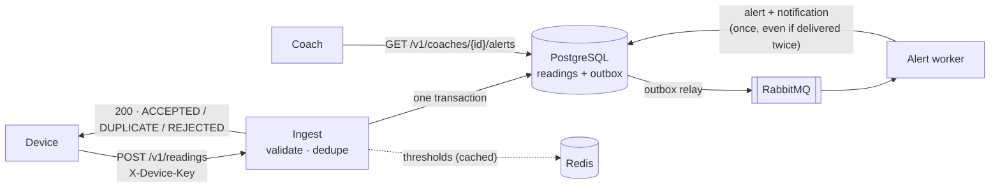

# VitalLink · Readings & Alerting Service

**Takes in vitals from connected medical devices, ignores duplicate retries, stores every reading, and alerts the patient's care coach, without ever slowing ingest down during the 6–9 AM peak.**


---

## 🧰 Tech stack

| | |
|---|---|
| **Language & framework** | Java 25 (virtual threads) · Spring Boot 4.1 (Spring MVC, Spring Security, JdbcTemplate) |
| **Database** | PostgreSQL 18, readings partitioned by day · Flyway migrations |
| **Messaging** | RabbitMQ 4.3: quorum queues, dead-letter queues, publisher confirms · transactional outbox |
| **Cache** | Redis 8: per-patient thresholds, cache-aside |
| **Testing** | JUnit 6 + Testcontainers (real PostgreSQL, RabbitMQ and Redis) · k6 load test |
| **Running** | Docker Compose (one command) · Spotless formatting |

---

## ✨ At a glance

| | |
|---|---|
| **~34,000 readings/s** | on one instance on a laptop, 0 errors, p99 18 ms ([load test](docs/load-test.md)) |
| **Exactly one alert** | per breaching reading, even when the device retries or two workers race |
| **0 alerts lost** | when RabbitMQ is down: readings are still accepted, alerts follow when it's back |
| **Ingest never waits** | on Redis, RabbitMQ or the AI model; each has a timeout and a fallback |
| **One command** | `docker compose up --build -d`, then curl or Postman |

---

## 🗺️ Where to find each part

| Part | Where |
|---|---|
| **A** · The service | this README · [run & test it](docs/runbook.md) · [Postman collection](docs/vitallink.postman_collection.json) |
| **B** · System design, diagram, 7:15 AM incident | [docs/design.md](docs/design.md) |
| **C** · AI reading summary | [below](#-ai-reading-summary-part-c) |
| **D** · How I worked with AI | [below](#-how-i-worked-part-d) |
| **E** · Conventions + code-review take | [below](#-design-decisions--conventions-part-e) |

---

## 🔄 How a reading flows



1. **Accept fast.** The device's batch is validated and saved, with an outbox event for each breach, in **one transaction**. `ACCEPTED` means it's in PostgreSQL, so the device can delete its copy.
2. **Alert later.** The relay publishes outbox events to RabbitMQ; a worker stores the alert and notifies the coach. A slow alert path can never slow ingest.
3. **Never twice.** Unique constraints in PostgreSQL turn device retries and repeated deliveries into no-ops.

**Scope:** blood pressure end to end (the brief allows one metric); stretch goals left out on purpose.

---

## 🚀 Run it

```bash
docker compose up --build -d      # only Docker needed: service + PostgreSQL + RabbitMQ + Redis + demo data
```

Then pick one:

- **curl** · [docs/runbook.md](docs/runbook.md) walks through every feature (happy path, duplicate, alert, threshold change, failure modes) with the expected output under each command.
- **Postman** · import [docs/vitallink.postman_collection.json](docs/vitallink.postman_collection.json) and click *Run collection*.

> [!TIP]
> **Fastest check:** send a reading above patient-001's limit (systolic 180), then open the coach's queue.
>
> ```bash
> curl -s localhost:8080/v1/readings \
>   -H 'X-Device-Key: local-key-bp-001' \
>   -H 'Content-Type: application/json' \
>   --data @- <<EOF | jq
> {
>   "readings": [{
>     "readingId":  "$(uuidgen)",
>     "metricType": "BLOOD_PRESSURE",
>     "systolic":   185,
>     "diastolic":  112,
>     "measuredAt": "$(date -u +%Y-%m-%dT%H:%M:%SZ)"
>   }]
> }
> EOF
>
> sleep 1    # the alert is raised in the background
> curl -s localhost:8080/v1/coaches/coach-asha/alerts | jq
> ```

**Tests:** `./mvnw verify`

---

## 📌 Key assumptions

The brief leaves some things open. The ones that shape the design:

- **A1–A2 · Retries are recognisable.** Each reading carries a device-generated `readingId` (UUID), reused on retry and unique per device.
- **A6 · `ACCEPTED` means durable.** Saved in PostgreSQL before we answer; alerts follow within seconds.
- **A3, A9 · Always a batch, partly accepted.** Up to 500 readings; one bad reading never loses the good ones.
- **A5 · Other systems own the reference data.** Device-to-patient mapping, thresholds and coach panels are local copies (seed data here).
- **A12 · One breach, one alert, one notification.** Grouping alerts is the first thing I'd add.

<details>
<summary><b>All 17 assumptions, with reasons</b></summary>

| # | Assumption | Why |
|---|---|---|
| A1 | The device sends a unique `readingId` (UUID) per reading and reuses it on retry. | Time alone can't tell a retry from a second reading in the same second. |
| A2 | `readingId` is unique per device, not globally. | One device's reading must never count as a duplicate of another's. |
| A3 | A batch can be partly accepted: each reading gets `ACCEPTED`, `DUPLICATE` or `REJECTED`. | One bad reading shouldn't lose the good ones. |
| A4 | Only blood pressure is built end to end. | The brief allows one metric; one done fully beats many halfway. |
| A5 | Device-to-patient mapping, thresholds and coach panels are owned by other services; here they are seed data. | This service only reads them. |
| A6 | `ACCEPTED` means saved in PostgreSQL; alerts follow within seconds. | The device deletes its copy on `ACCEPTED`, so it must already be durable. |
| A7 | Local Docker uses a throwaway password and demo device keys. Production takes every credential from a secret manager and never loads demo data. | "No secrets in the repo" and "one command to run" both hold. |
| A8 | Scale figures beyond the brief's are my estimates ([design doc §2](docs/design.md#2-scaling-to-1m-devices-and-50m-readings-a-day)). | Sizing partitions and the database needs them. |
| A9 | Every request is a batch (a single reading is a batch of one), at most 500. | One code path for duplicates and validation; no huge request holds a connection. |
| A10 | A retry resends the reading unchanged, including `measuredAt`. | The duplicate key includes `measuredAt` (PostgreSQL needs the partition column in it). A changed time on retry is a firmware bug, found by a periodic query rather than an extra check on every insert. |
| A11 | Each patient has their own limits per metric and one alert level. | "Each patient has thresholds per metric"; one level shows the full path. |
| A12 | Each breaching reading raises one alert and one notification; a retry never raises a second. | The brief's rule. Grouping alerts is under "Left out on purpose". |
| A13 | A patient has one coach. With no coach, the alert is still stored and a warning logged. | An alert must never be dropped because nobody is assigned. |
| A14 | The care-plan system announces limit changes with a `ThresholdsChanged` event holding the full new set. | The owner pushes changes; the event also clears the cache. |
| A15 | The read APIs have no login here; production uses OAuth2/OIDC and coaches see only their patients. | The brief asks for one scheme implemented (device keys) and the rest described. |
| A16 | Readings are kept 7 years: 6 months in PostgreSQL, older in object storage. | The real period depends on regulations not in the brief. |
| A17 | The summary uses a stub model by default; no API key needed. | The brief accepts a stub; the timeout, call limit and fallback around it are real and tested. |

</details>

---

## 🔌 API

### Send readings

`POST /v1/readings` with the device's key in `X-Device-Key`. `patientId` is optional; if sent, it must be the device's patient.

```json
{
  "patientId": "patient-001",
  "readings": [
    {"readingId": "0b8f0c4e-6a1e-4c55-9f3a-1d2e3f4a5b6c", "metricType": "BLOOD_PRESSURE",
     "systolic": 182, "diastolic": 111, "pulse": 74, "measuredAt": "2026-10-12T07:02:00Z"}
  ]
}
```

Always `200`, with one result per reading, in order: `{"results": [{"readingId": "0b8f…", "status": "ACCEPTED"}]}`

| Result | Meaning | The device should |
|---|---|---|
| `ACCEPTED` | stored in PostgreSQL | delete its copy |
| `DUPLICATE` | already stored (earlier, or twice in this batch) | delete its copy |
| `REJECTED` | invalid, with a `reason`; not stored | not retry; report it |

Whole-request errors use the standard JSON error format (RFC 9457):

| Status | When |
|---|---|
| `400` | body missing, malformed or empty |
| `401` | key missing, unknown or revoked |
| `403` | `patientId` isn't the device's patient |
| `413` | more than 500 readings |
| `500` | no database connection free within 2 s |

> [!NOTE]
> Under overload this build answers `500` after 2 s. Production answers `503` + `Retry-After`; see [Left out on purpose](#-left-out-on-purpose). Readings older than 30 days are rejected.

### Read data

No login in this exercise (A15); production uses OAuth2/OIDC.

| Endpoint | Returns |
|---|---|
| `GET /v1/patients/{id}/readings/latest?limit=20` | newest readings from the last 30 days (`limit` 1–100) |
| `GET /v1/patients/{id}/readings?from=…&to=…&limit=100` | readings in `[from, to)`, newest first, ≤ 90 days (`limit` 1–500) |
| `GET /v1/coaches/{id}/alerts?limit=50` | the coach's alerts, newest first (`limit` 1–200) |
| `GET /v1/patients/{id}/summary?days=7` | AI summary of recent readings (1–30 days), see [Part C](#-ai-reading-summary-part-c) |

Each reading has `measuredAt` (device time) and `receivedAt` (our time); a big gap means a late upload.

---

## ⚡ Threshold cache

- **Cache-aside, per patient, 24 h.** Ingest reads Redis first; on a miss, PostgreSQL. Devices send every 30 min to a few hours, so a short expiry would almost never hit.
- **Invalidated by events.** A `ThresholdsChanged` event (A14) replaces the copy in PostgreSQL, deletes the cache entry, and deletes it again a second later to catch a stale write-back.
- **Optional at runtime.** Redis down → ingest reads PostgreSQL and the service stays healthy.

---

## 🤖 AI reading summary (Part C)

`GET /v1/patients/{patientId}/summary?days=7` (1–30 days) gives a coach a short summary of a patient's recent readings. The model is advisory: it must never make the request fail or hang, and it never touches ingest or alerting.

```json
{"patientId": "patient-001", "days": 7, "source": "LLM", "summary": "...",
 "facts": {"readingCount": 12, "averageSystolic": 141, "averageDiastolic": 86, "highestSystolic": 185,
           "lowestSystolic": 122, "breaches": 2, "trend": "rising"}, "generatedAt": "2026-10-13T07:20:00Z"}
```

- 🧮 **Facts first.** Our code computes the numbers from PostgreSQL; the model only turns them into sentences, and the facts are returned next to its text so the coach can check them. `source` is `LLM`, or `FALLBACK` when our code wrote the text from the facts.
- ⏱️ **Timeout and fallback.** The call is cut off after 3 s. Slow, down, rate limited, erroring or empty all give the fallback; nothing is retried while a coach waits. With no readings the model isn't called.
- 💸 **Cost and rate limits.** At most 4 calls at once per instance; over that, the fallback at once instead of a queue. Small prompts suit a short-text model such as Claude Haiku. With a real model I'd cache each summary in Redis for a few minutes and alarm on daily spend.
- 🔒 **PHI.** The prompt holds only numbers and day counts, never a patient ID or name. A real provider still needs a business associate agreement.
- ✅ **Quality.** Automatically: every number in the text must appear in the facts, or the fallback is used; a fixed set of example patients is rerun on every prompt or model change. With people: coaches flag wrong summaries, and a clinician reviews a sample weekly.

---

## 📈 Load test

A k6 burst on one laptop: one instance, a pool of 10 connections, 5% retries, 1% breaches.

| Readings/s | Errors | p50 / p95 / p99 | Retries deduplicated | Alert backlog |
|---|---|---|---|---|
| **~34,000** (3× the designed peak) | **0** of 678k requests | 5 / 11 / 18 ms | **100%** | < 1 s |

**The limit is database work per request, not CPU:** a pool of 20 gave only +17% throughput for +40% database CPU. Method, full numbers and what a laptop can't show: [docs/load-test.md](docs/load-test.md).

---

## ✂️ Left out on purpose

The brief asks for a credible core, not a complete platform. Next, in rough order (the design doc explains each):

- **Login for coaches and staff** (OAuth2/OIDC), with each coach seeing only their own patients, and cover when a coach is away.
- **Grouping alerts:** one open alert per patient and metric, updated by new breaches, with the coach notified only when it opens or gets worse, plus a history of every breach. About 150 alerts per coach per day would otherwise cause alert fatigue.
- **Severity levels** (warning and critical), and acknowledging or resolving alerts.
- **Default thresholds per program** for patients who have none of their own.
- **A queue for alerts with no coach,** for operations staff to act on.
- **Backpressure:** answering `503` with `Retry-After` when the database is overloaded.
- **Metrics and alarms:** outbox lag, partitions ready ahead, cache hit rate, ingest results.
- **Paging** through long time ranges.

---

## 🧑‍💻 How I worked (Part D)

I used **Claude Code** (Claude Opus) in the terminal, inside this repository, mainly for **code generation**: the Spring Boot service, the SQL migrations, the seed data (demo devices, coaches and thresholds), the tests, the Docker setup and the k6 script. It also helped with first drafts of the docs and with checking current library versions. I made the design decisions, reviewed every change and approved every commit myself.

**Where it helped**
- Fastest at parts that are easy to check: boilerplate, test cases, and SQL I could run straight away.
- Good at checking its own claims when asked to run the real thing instead of trusting a green build:
  - it stopped RabbitMQ mid-run to show an alert is delayed, not lost;
  - it ran `EXPLAIN` on "latest readings" and found it opened every daily partition, which the passing tests hadn't shown;
  - it reran the load test with a bigger pool to test its own bottleneck claim (+17% throughput, +40% database CPU).

**Where I had to correct it**
- **A cache that would never hit.** It proposed caching device keys and thresholds for 60 seconds. When I asked how often the same key comes back, the answer was every 30 minutes or more. Its next idea saved nothing once we read the query it was meant to replace. The design we kept (each patient's limits, deleted when they change) came from checking the access pattern.
- **Scope creep.** Over many steps it proposed sensible extras (alert grouping, severity levels, coach login, an admin API, custom metrics), and I accepted several. When I checked them against the brief, none were asked for. I removed them and listed them under "Left out on purpose".
- **Smaller cases:** library versions from an outdated index that crashed on Java 25 (I checked Maven Central), and an admin API secured with a shared key right after it had said people should log in with JWTs.

**What I'd ask of a team using these tools**
- Treat the output as a draft from a fast, confident colleague who doesn't know our constraints.
- Check versions and facts at the source, run the app the way a user would, read the query plan, and look at the data before the summary.
- Deciding what *not* to build stays with the engineer. The tool makes adding things cheap, which makes saying no more important.

---

## 🧭 Design decisions & conventions (Part E)

For the engineer who owns this service next.

- **How it works, in one line:** a reading is saved to PostgreSQL first, and that save is what "accepted" means. Everything that follows (alert, notification) happens later through the outbox and RabbitMQ, so the alert path can never slow ingest.
- **Why each choice:** [Key assumptions](#-key-assumptions) and [docs/design.md](docs/design.md).
- **Three rules hold this together.** Please hold the line on them in review, mine included.

### 1. Anything another system must hear about goes through the outbox, in the same transaction

- **The rule:** `ReadingIngestService` saves the reading and its `outbox` row in one transaction; `OutboxRelay` publishes later. Never call RabbitMQ or another service from the code that saves the data.
- **Why it matters here:**
  - save, then publish: a crash in between loses the alert;
  - publish, then save: a coach can be alerted about a reading that was never stored;
  - a slow call inside a transaction holds a connection and its locks, which is how a broker hiccup becomes an ingest outage.
- **In review, ask:** is there a RabbitMQ, HTTP or model call near a database write?

### 2. Every consumer must be safe to run twice, and the database decides what is a duplicate

- **The rule:** use a unique constraint plus `ON CONFLICT DO NOTHING` (`alerts_reading_unique`), and create the notification only when the insert added a row.
- **Why it matters here:**
  - RabbitMQ delivers at least once, and the relay can publish twice, so duplicates are normal, not rare;
  - a duplicate alert pages a coach twice, and coaches who get double pages learn to ignore them;
  - a Java "exists? then insert" check loses the race when two workers run at the same instant.
- **In review, ask:** what if this message arrives twice, at the same moment? Prove it against real PostgreSQL, as `ConcurrentRetryTest` and `AlertPipelineTest` do.

### 3. Database changes must be safe on a live, busy table

- **The rule:**
  - never edit a released migration; add a new one;
  - expand, then contract, to rename or change a column;
  - `CREATE INDEX CONCURRENTLY`;
  - always set `lock_timeout`, so a migration that can't get its lock fails fast.
- **Why it matters here:** `readings` takes inserts all day, most between 6 and 9 AM. This is the [7:15 AM incident](docs/design.md#7-a-live-incident-715-am): a schema change left open in a console queued every insert behind its lock.
- **In review, ask:** what lock does this take, on which table, and for how long?

### A code-review take on my own shortcut

The brief asks for one place where I knowingly cut a corner, and the review comment I'd want a senior engineer to leave on it.

**The shortcut** (`OutboxRelay.java:103`): every 200 ms, the relay picks up to 100 unsent alert events from the `outbox` table, sends them to RabbitMQ, and waits for RabbitMQ to say "got them" before marking them sent. It does that waiting **while its database transaction is still open**: it holds one database connection and keeps those outbox rows locked for up to 5 seconds. That's exactly what rule 1 above tells everyone else not to do.

**The review comment I'd want:**

> **Why this is fine for now**
> - Only `outbox` rows are locked, never `readings`, so devices can still send readings.
> - It holds just **one** connection per instance, and never for more than 5 seconds.
> - If anything goes wrong, nothing is marked sent, so the events are simply sent again on the next run. No alert is lost.
>
> **When it would hurt**
> - Not when RabbitMQ is down (that fails fast), but when it is **slow**. If RabbitMQ took 4 seconds to answer during the 7 AM peak, the relay would keep 1 of our 10 database connections busy almost all the time, and some events would be sent twice.
>
> **What to do**
> 1. **Now:** measure how long RabbitMQ takes to answer, and add a code comment explaining why this one place may break rule 1, so nobody copies it into code that touches `readings`.
> 2. **Later** (if RabbitMQ's answers regularly take over ~100 ms, or before sending bigger batches): split the work into three steps, so no transaction stays open while we wait:
>    1. a quick transaction marks the events as "being sent" and commits;
>    2. send them to RabbitMQ, with no transaction open;
>    3. a second quick transaction marks them as sent.

**One more thing I'd fix first**, because it's a mistake rather than a deliberate trade-off: the job that creates the daily `readings` partitions doesn't set a `lock_timeout`. If it ever got stuck waiting for a lock, every incoming reading could queue up behind it, which breaks my own rule 3.
