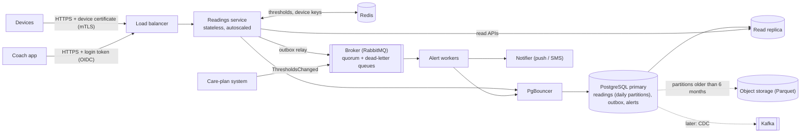

# 🏗️ VitalLink Readings & Alerting · Design at scale

**How this service would run at ~1 million devices and 50 million readings a day, with sharp morning bursts, and where the built version differs from what I would ship.** The README covers what was built and why.

[← Back to README](../README.md) · [Load test](load-test.md) · [Runbook](runbook.md)

| # | Section | In one line |
|---|---|---|
| 1 | [Target architecture](#-1-target-architecture) | Managed PostgreSQL, Redis and broker; PostgreSQL stays the first write |
| 2 | [Scaling](#-2-scaling-to-1m-devices-and-50m-readings-a-day) | Designed for 10,000 readings/s; what breaks first, in order |
| 3 | [Data at scale](#-3-data-at-scale) | Daily partitions, 6 months hot, archive, shard by patient |
| 4 | [Correctness under stress](#-4-correctness-under-stress) | The database decides duplicates; nothing lost when a dependency fails |
| 5 | [Healthcare](#-5-healthcare-phi-security-and-audit) | mTLS devices, OIDC coaches, minimum data, encryption, write-once audit |
| 6 | [Observability](#-6-observability) | Age-based alarms, two SLOs, an end-to-end canary |
| 7 | [Live incident: 7:15 AM](#-7-a-live-incident-715-am) | Scope → shared component → stabilise → prevent |
| 8 | [Trade-offs](#-8-trade-offs-the-built-version-vs-production) | Each shortcut, its production version, and why it's fine here |

---

## 🧱 1. Target architecture

Production uses **managed services**, so the team doesn't operate stateful systems holding health data: patching, backups and multi-zone failover come from the provider, under its HIPAA business associate agreement.

- The cloud is usually already chosen by the organisation; the design runs on any of the large three.
- The one real difference is the broker: only AWS offers managed RabbitMQ. Elsewhere the alert queue moves to the cloud's own queue service, and only the outbox relay and the listeners change.

| Piece | AWS | Azure | Google Cloud |
|---|---|---|---|
| PostgreSQL | Aurora / RDS | Azure Database for PostgreSQL | Cloud SQL / AlloyDB |
| Redis | ElastiCache | Azure Cache for Redis | Memorystore |
| Broker | Amazon MQ (RabbitMQ) | Service Bus | Pub/Sub |
| Containers | ECS / EKS | AKS | GKE / Cloud Run |
| Archive | S3 | Blob Storage | Cloud Storage |

**A reading's path is unchanged from the built version:** validated, stored in one transaction with an outbox event for each breach, and answered per reading. The relay and workers do the alert work off the ingest path.

> [!IMPORTANT]
> **PostgreSQL stays the first place a reading is saved, not Kafka.** Kafka in front would absorb bursts, but the volume doesn't need it, "accepted" would mean "in Kafka", and devices could no longer be told `DUPLICATE` at once. Devices already buffer offline, so under overload a `503` with `Retry-After` makes *them* the burst buffer. Kafka, fed by change data capture, comes when several consumers need every reading.

---

## 📈 2. Scaling to 1M devices and 50M readings a day

| | Average | Peak (designed for) |
|---|---|---|
| **Readings per second** | ~580 | **10,000** |
| **Requests per second** (batches of 5) | ~120 | **2,000** |
| **Alert events per second** (1% breach) | ~6 | **~100** |

<b>How I got these numbers</b>

The brief gives 1M devices and 50M readings a day, mostly 6–9 AM. The rest are my estimates:

- **Peak:** 60% of readings in the morning window (~2,800/s), ×3 at the top of the hour and when offline devices reconnect, so I design for **10,000 readings/s**.
- **Requests:** batches of 5 on average, so ~2,000 write requests/s at peak.
- **People:** 1.5 devices per patient (~670k patients) and 200 patients per coach (~3,300 coaches), refreshing every ~30 s: ~100–300 read requests/s. The system is **write-heavy**, so the insert path stays lean.
- **Storage:** ~200 bytes per reading (measured: ~175), so ~10 GB a day; hence daily partitions.

> [!WARNING]
> **Two red flags in these numbers.**
> - 50 readings per device per day is far more than a blood pressure cuff sends, so most volume must come from frequent senders like pulse oximeters.
> - ~150 alerts per coach per day is more than a person can act on (point 4 below).

In the [load test](load-test.md), one instance on a laptop handled **~34,000 readings/s**, limited not by CPU but by database work per request: all 10 connections were busy and requests waited for them.

**What breaks first, in order:**

1. **Database work and connections.** Each request makes two round trips (the device key lookup and the insert).
   - Cache device keys in Redis.
   - Put PgBouncer in transaction mode in front of PostgreSQL, so many autoscaled instances share a few hundred real connections. Raising every instance's pool instead would exceed PostgreSQL's connection limit.
2. **Overload.** When no connection frees up quickly, answer `503` with `Retry-After` rather than queue. Left out of the built version as a stretch goal; it's the first thing I'd add.
3. **One primary.** 10,000 batched inserts a second fits one well-sized PostgreSQL primary. Beyond that, shard by patient (§3).
4. **Alerting.** ~100 events a second is small for the broker; workers scale by adding consumers. **The real limit is people:** 500,000 alerts a day is ~150 per coach. Grouping repeated breaches into one open alert per patient and metric, notifying only when it opens or gets worse, is the first change to alerting.
5. **Reads** go to a read replica, so they never compete with the morning burst.

---

## 💾 3. Data at scale

**Partitioning**
- Readings are partitioned by **UTC day** on `measured_at`. Queries filter by time, so PostgreSQL skips other partitions.
- Inserts always hit today's partition, whose index (~4 GB a day) stays in memory during the burst, where a monthly one (~130 GB) would not.
- Each insert maintains just two indexes:
  - the primary key `(device_id, reading_id, measured_at)`, which is also the duplicate check;
  - `(patient_id, measured_at)` for reads.
- In production `pg_partman` creates partitions ahead, with an alarm below 7 days ready; a default partition catches stray rows.

**Retention** (README A16)
- The last **6 months** stay in PostgreSQL, ~1.8 TB.
- Each night the oldest day is exported to object storage as Parquet, checked, then **detached and dropped**: instant, unlike a large `DELETE`, and no bloat.
- Lifecycle rules keep the files for the required years (assumed 7), queryable in place for audits.

**Fast reads as data grows**
- Every read is bounded by time ("latest" covers 30 days, a range at most 90), so it opens only those partitions and uses the patient index in each.
- A coach's queue is one index lookup on `(coach_id, created_at)`.

**Beyond one database:** shard by patient. The patient is in every query, a device belongs to one patient, and alerts are per patient, so no request crosses shards.

---

## 🎯 4. Correctness under stress

**Duplicates: the database decides, not the code**
- `INSERT ... ON CONFLICT DO NOTHING RETURNING` stores exactly one copy, even when two retries arrive at the same moment (tested with 8 threads).
- Only newly stored readings get an outbox event, so a retry never re-fires an alert.
- Delivery to the worker is at-least-once; the alert's unique key is the reading's, so a repeated event adds nothing.
- *Known gap:* a retry with a changed `measuredAt` is stored twice (README A10).

**Late and out-of-order data**
- Each reading keeps the device's `measuredAt` and our `receivedAt`, so a late upload lands in its own day and the gap is visible.
- Readings up to 30 days old are accepted; future-dated ones aren't checked (§8).
- Every breach raises its own alert, so arrival order doesn't matter.
- *The exception:* out-of-order `ThresholdsChanged` events could leave older limits in place, so at scale each carries a version and older ones are ignored.

**Partial outages:** only PostgreSQL is on the ingest path; everything else can fail without losing a reading.

| What fails | What happens |
|---|---|
| **Broker** | Events wait in the outbox; the relay retries until the broker confirms. *Tested:* ingest stayed at 45 ms, the alert arrived ~10 s after restart. |
| **Alert worker** | Events wait in a replicated queue; a failing one is retried 5 times, then parked in a dead-letter queue. |
| **Redis** | Thresholds come from PostgreSQL (*tested*); Redis isn't in the health check. |
| **PostgreSQL** | Waits for a connection time out after 2 s; production answers `503` with `Retry-After`, and devices retry with random delays. |
| **An instance** | Nothing is acknowledged before commit; its outbox rows are released and sent by another instance. |

---

## 🏥 5. Healthcare: PHI, security and audit

| Area | How |
|---|---|
| **Devices** | Each device has its own certificate from manufacturing (mTLS), so no reusable secret travels and a lost device is revoked by its certificate. *Built version: hashed API keys.* |
| **Coaches** | Log in through the identity provider (OIDC, multi-factor) and see only their own panel's patients, checked on every request. *Built version: no login on the read APIs (README A15), the largest gap from production.* |
| **Database roles** | Least privilege: ingest can insert readings but not delete them. |
| **Minimum necessary data** | Only a patient ID is stored, never a name or date of birth. Logs and errors carry device and alert IDs, never patient data. |
| **Encryption** | TLS on every hop, including to the database, broker and Redis. Everything at rest (database, backups, broker, cache, archive) encrypted with keys in the cloud's key service. Secrets from a secrets manager, never images or the repository. |
| **Audit** | Every read or change of a patient's data emits an audit event (who, which patient, what, when, request ID) to **write-once storage in a separate security account**, kept for the retention period, so nobody, including our administrators, can alter it. If the audit write fails, the request fails. Keeping it out of the main database also keeps a write off every read. |
| **Around the service** | Data stores on a private network behind the only public entry, the load balancer. Every vendor touching PHI, including any LLM provider (Part C), needs a business associate agreement. Restores tested on a schedule. |

---

## 🔭 6. Observability

Structured JSON logs without PHI, metrics, and traces (OpenTelemetry). The trace ID is carried from the HTTP request into the outbox event and the worker, so **one reading can be followed end to end**.

| Area | Signals | Alarm when |
|---|---|---|
| **Ingest** | requests, errors by status, latency p50/p95/p99, results (accepted, duplicate, rejected) | p99 or 5xx rate rises; rejected share jumps (often one firmware version) |
| **Database** | connections busy and waiting, slowest queries (`pg_stat_statements`), locks and long transactions (`pg_stat_activity`), CPU, I/O, replica lag | requests waiting for connections; replica lag over a few seconds |
| **Alerting** | age of the oldest unsent outbox event, queue depth and oldest message age, dead-letter queue size, time from reading to notification | outbox age over 60 s; anything in a dead-letter queue |
| **Partitions and cache** | future partitions ready, rows in the default partition, cache hit rate and errors | fewer than 7 days ready; any row in the default partition |

- **Alarm on age, not counts.** 2,000 waiting events at 7 AM can be fine if they leave within a second; 3 waiting for 10 minutes is an outage.
- **Two objectives anchor the alarms:**
  - 99.9% of ingest requests succeed in under 500 ms;
  - 99% of alerts reach the coach within 60 seconds.
- **The pipeline is watched end to end:** a canary device sends a breaching reading every minute, and an external check pages if its alert doesn't arrive.

---

## 🚨 7. A live incident: 7:15 AM

> [!CAUTION]
> *Ingest p99 has tripled in ten minutes, the alert queue is backing up, and coaches are paging about stale data.*

### Step 1 · First two minutes: scope and change
- **Scope:** every instance and endpoint, or one instance or zone? (Request graphs by instance; the load balancer by zone.)
- **Change:** what changed in the last half hour? A deploy, a migration (`flyway_schema_history`), a scheduled job, or more traffic than a normal Monday?
- If a deploy went out at 7:05, **roll it back first and investigate second.**

### Step 2 · What do the two symptoms share?
- Ingest and alerting slowed **together**. RabbitMQ is only on the alert side and Redis only on the ingest side.
- What both share is **PostgreSQL** and, in this design, the same service process and connection pool (the relay and the alert worker run inside the service).
- So I start at the database:
  - requests waiting for a connection (`hikaricp.connections.pending`);
  - what every session is doing now (`pg_stat_activity`);
  - database CPU and I/O.

### Step 3 · Likely causes, and how to tell them apart

| Cause | Signature |
|---|---|
| **Bigger burst than usual** (devices reconnecting after a network outage) | request rate up; each query's time unchanged (`pg_stat_statements`: more calls, same average) |
| **A slow query** (bad plan after a migration or statistics change) | normal traffic; one query's average time jumps; CPU or I/O high |
| **Lock contention** (migration, long transaction, our hourly partition job) | many sessions waiting on `Lock`, database CPU low; `pg_blocking_pids()` names the blocker |
| **Disk saturation** (throughput limit, checkpoint, vacuum) | sessions waiting on `IO`; CPU moderate |
| **Redis down** | cache-unavailable warnings; every request adds a threshold query to the database |
| **The service itself** (leak, garbage-collection pauses) | process CPU or GC pauses high while the database is calm |

### Step 4 · Stabilise now
Say sessions wait on `Lock` behind one that has been **"idle in transaction" for 12 minutes**, after someone started a schema change in a console.

1. Check who owns it (`usename`, `application_name`, `xact_start`) and tell them.
2. `pg_terminate_backend(pid)`: the transaction rolls back cleanly, the lock is released, and inserts flow within seconds.
3. **Not** more connections or instances: they would join the same lock queue and exhaust the connection limit.
4. The outbox and queue then drain on their own (alerts delayed, never lost); expect a short retry spike.

*Other causes:* shed a burst with `503` and add capacity; roll back a bad migration or fix the plan; restore Redis.

### Step 5 · Afterwards: make it impossible next time
- **Timeouts:**
  - `idle_in_transaction_session_timeout` (60 s) ends a forgotten transaction by itself;
  - `lock_timeout` (a few seconds) for migrations and our own hourly partition job, so DDL gives up instead of queuing ahead of every insert;
  - `statement_timeout` for runaway queries.
- **Process:** schema changes only through the reviewed pipeline at quiet hours, using `CREATE INDEX CONCURRENTLY` and expand-and-contract steps; read-only consoles by default.
- **Alarms** on the oldest open transaction and on lock waits would have paged at ~7:06, before the coaches.
- **A blameless post-mortem:** why was it possible, not who did it.

---

## 📋 8. Trade-offs: the built version vs production

Each of these was a deliberate shortcut for a 3–4 day exercise; the README's "Left out on purpose" lists the features not built at all.

| Built | Production | Why fine here |
|---|---|---|
| Read APIs without login | OIDC; coaches see only their patients; access audited (§5) | The brief asks for one auth scheme |
| Device API keys | A certificate per device (mTLS) | Needs a certificate authority and provisioning |
| No overload response | `503` + `Retry-After` | A stretch goal; the pool fails fast after 2 s |
| One alert per breaching reading | One open alert per patient and metric | The brief asks for an alert per breach (§2) |
| Future-dated readings accepted | Reject more than a few minutes ahead | One broken clock could block a future partition |
| Service creates partitions, no lock timeout | `pg_partman`, `lock_timeout`, `ATTACH PARTITION` | Partitions exist 30 days ahead; a default partition catches strays |
| Retry with a changed `measuredAt` stored twice | Same, plus a periodic check that flags the firmware | Cheaper than a check on every insert (A10) |
| Relay holds a transaction while the broker confirms | Claim rows, publish outside the transaction | ~100 events/s at peak; no backlog in the load test |
| Cache deletes retry ~10 s, then dead-letter | Longer delayed retry, or versioned entries | Retry policy shared with alert jobs |
| Relay and worker share the ingest process and pool | Separate worker deployment and pool | One deployable is simpler; §7 shows the coupling |
| Logs and Spring's built-in metrics | §6's signals, traces and canary | Described, to keep the code to the brief |
